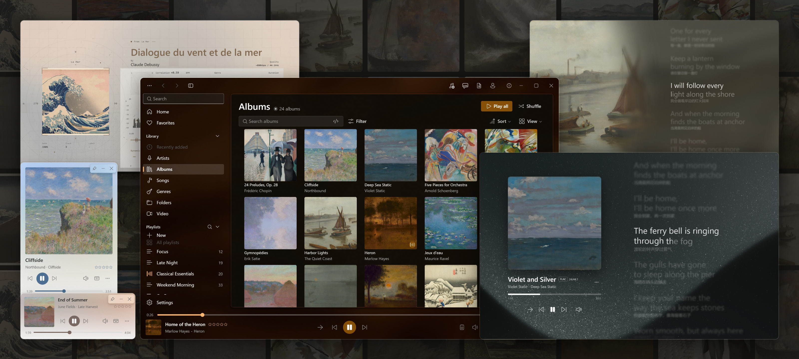

English | [中文](./README.zh-CN.md)

<p align="center">
  
</p>

# foo-webview-default-theme

[](LICENSE)
[](https://github.com/NereaFantasia/foo-webview-default-theme/releases)
[](https://github.com/NereaFantasia/foo_ui_webview2)

Default Theme is the default theme for [foo_ui_webview2](https://github.com/NereaFantasia/foo_ui_webview2). It gives foobar2000 a WinUI 3 style interface, built with React 19 and Fluent UI React v9, and reaches the player only through [foo-webview-sdk](https://www.npmjs.com/package/foo-webview-sdk).

- License: AGPL-3.0-only
- Interface languages: English, Simplified Chinese

---

## Features

- Cover colors — the palette follows the album art
- Home — quick entries, local statistics and recommendations, plus NetEase charts, playlists and new albums
- Artist pages — a header image, top tracks and albums, with biographies from Apple Music or Last.fm
- Immersive view — a Blueprint style with spectrum, stereo field and waveform in real time, or a lyrics-first style with an optional full-bleed cover and a cover flow
- Lyrics — word-by-word highlighting, with translations, and an optional desktop window
- Online music — search and play NetEase Cloud Music, with other platforms once you import sources
- Autoplaylists — create and edit them from query conditions, with syntax coloring and completion in the query box
- Mini player — a compact layout and an expanded-cover layout
- Online updates — check for and install new versions in Settings, with automatic rollback when a new version fails to start

---

## Showcase

### Cover colors

https://github.com/user-attachments/assets/3d3e6ab5-0ad8-48af-b1f5-dcde3ca725c5

<table>
  <tr>
    <td width="50%" valign="top">
      <b>Artist · Michael Jackson</b><br />
      <video src="https://github.com/user-attachments/assets/e22903f1-e4b7-4522-bc5a-1a0c80e397d0" width="100%"></video>
    </td>
    <td width="50%" valign="top">
      <b>Online music</b><br />
      <video src="https://github.com/user-attachments/assets/f32a77d3-7e63-4223-a1e9-073b6d947e4b" width="100%"></video>
    </td>
  </tr>
  <tr>
    <td width="50%" valign="top">
      <b>Immersive · Lyrics</b><br />
      <video src="https://github.com/user-attachments/assets/8be050ab-853e-4f72-86b5-db45456dd4d5" width="100%"></video>
    </td>
    <td width="50%" valign="top">
      <b>Immersive · Full-bleed cover</b><br />
      <video src="https://github.com/user-attachments/assets/620ad810-1a2b-4c9a-b0e9-2266e5277f4e" width="100%"></video>
    </td>
  </tr>
  <tr>
    <td width="50%" valign="top">
      <b>Video</b><br />
      <video src="https://github.com/user-attachments/assets/6b87fd69-5a04-46c3-9b26-49c7c2687de0" width="100%"></video>
    </td>
    <td width="50%" valign="top"></td>
  </tr>
</table>

---

## Installation

Requires foo_ui_webview2 2.2.0 or later, running as the standalone window (`Webview2 UI` as the default user interface). In DUI and CUI panels the theme only shows a notice that panels are not supported.

**With the installer (recommended)**

1. Download `foo-webview-default-theme-setup-<version>.exe` from [Releases](https://github.com/NereaFantasia/foo-webview-default-theme/releases) or the [CNB mirror](https://cnb.cool/foo-ui-webview2/default-theme/-/releases) and run it. Choose the foobar2000 folder; the installer adds the component and the theme without changing foobar2000's configuration.
2. Start foobar2000 and, when it asks which user interface module to use, select Webview2 UI.

The installer is unsigned, so Windows SmartScreen asks for confirmation: choose More info, then Run anyway. It needs x64 Windows and foobar2000 2.0 or later; 32-bit and 64-bit foobar2000 are both supported.

**Manually**

1. Download `foo-webview-default-theme-<version>.zip` from [Releases](https://github.com/NereaFantasia/foo-webview-default-theme/releases) or the [CNB mirror](https://cnb.cool/foo-ui-webview2/default-theme/-/releases).
2. Extract it to `<profile>\webview-ui\<template>\` so that `index.html` sits directly in that folder.
3. Select the template on the foo_ui_webview2 preferences page, then restart foobar2000.

See the [user guide](./GUIDE.md) for setup and everyday use.

> The [CNB repository](https://cnb.cool/foo-ui-webview2/default-theme) is for distribution only: it holds the release packages and the manifest that online updates read. It contains no source code; source, issues and pull requests are here on GitHub.

## Online updates

Choose an update mode under **Settings > About**. The default is **Check manually**.

| Mode | Behavior |
|----|------|
| Check manually | No automatic checks |
| Notify only | Notifies you when a new version is available; you decide whether to install it |
| Install automatically | Downloads and installs new versions in the background |

A new version takes effect the next time foobar2000 starts. Every download is checked against its signature and hash, and a version that fails to start three times in a row is rolled back to the previous one. The theme never restarts foobar2000 by itself and does not update foobar2000. Component updates are installed from **Component update** under **Settings > About**; after you confirm, foobar2000 exits and restarts.

If no version can start, click **Reset startup counts and retry** on the loading page. If that does not help, extract the full package into a new folder and select that folder in the preferences.

## Reporting Problems

Copy the **Runtime log** under **Settings > About** and paste it into your report. See the [user guide](GUIDE.md#reporting-a-problem) for details.

---

## Building from Source

> You only need this section to develop the theme itself. Users install the release package — see Installation above.

### Requirements

- Node.js 24, npm 11
- Microsoft Edge (browser tests)

### Commands

```powershell
npm ci
npm run dev        # Dev server on port 5190
npm run build      # Output in dist/
npm test           # Unit tests (Vitest)
npm run test:e2e   # Browser tests (Playwright)
```

To work against the live player, turn on **Use development server** on the Developer page of the foo_ui_webview2 preferences and enter `http://127.0.0.1:5190`.

`vendor/applemusic-like-lyrics-core.tgz` is the lyrics core built from a pinned upstream commit; the commit, checksum and build steps are recorded in `vendor/applemusic-like-lyrics-core.json`.

### Tech Stack

| Layer | Technology |
|----|------|
| UI | React 19, Fluent UI React v9 |
| State | Jotai |
| Build | Vite 8, TypeScript 5.9 |
| Lyrics | Apple Music-like Lyrics |
| Cover colors | Material Color Utilities |
| Host bridge | foo-webview-sdk |
| Tests | Vitest, Playwright |

### Project Structure

```
foo-webview-default-theme/
├── src/
│   ├── boot/               # Loading page: version selection, startup check, rollback
│   ├── app/                # Service wiring, page table, providers
│   ├── shell/              # Window shell: title bar, sidebar, player bar, right card
│   ├── library/            # Library places: home, albums, artists, genres, songs, folders, favorites, online music, search
│   ├── playlist/           # Playlists
│   ├── immersive/          # Immersive view
│   ├── video/              # Video playback
│   ├── settings/           # Settings pages
│   ├── update/             # Online updater
│   ├── playback/ track/ table/ covers/ nav/ lyrics/                  # Shared domain modules
│   └── host/ server/ i18n/ theme/ motion/ styles/ kit/ diagnostics/  # Foundation
├── backend/                # Local service: online music, library and lyrics caches, updates
├── public/                 # Static assets
├── tests/
│   ├── unit/               # Unit tests (Vitest), mirroring src/
│   ├── e2e/                # Browser tests (Playwright)
│   └── fixtures/           # Host test doubles
├── scripts/release/        # Release packages, manifests and signing
├── vendor/                 # Lyrics core package
├── vite.config.ts          # App build
└── vite.boot.config.ts     # Loading page build
```

---

## License

This theme is licensed under the **GNU Affero General Public License v3.0 only** (AGPL-3.0-only); see [LICENSE](LICENSE) for the full terms.

Third-party code keeps its own license; see [THIRD_PARTY_NOTICES.md](THIRD_PARTY_NOTICES.md).

---

## Acknowledgements

- [foobar2000](https://www.foobar2000.org/)
- [foo_ui_webview2](https://github.com/NereaFantasia/foo_ui_webview2)
- [Fluent UI React](https://github.com/microsoft/fluentui)
- [Apple Music-like Lyrics](https://github.com/amll-dev/applemusic-like-lyrics)
- [Material Color Utilities](https://github.com/material-foundation/material-color-utilities)
- [OpenCC](https://github.com/BYVoid/OpenCC)
- [Lyricify Lyrics Helper](https://github.com/WXRIW/Lyricify-Lyrics-Helper)
- [foobox](https://github.com/dream7180) — the volume curve

Album covers, track titles and lyrics shown in the screenshots belong to their respective owners. foobar2000 belongs to its author.
