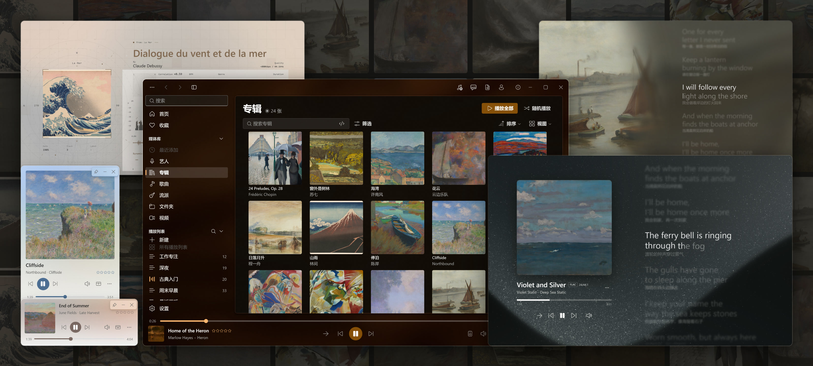

[English](./README.md) | 中文

<p align="center">
  
</p>

# foo-webview-default-theme

[](LICENSE)
[](https://github.com/NereaFantasia/foo-webview-default-theme/releases)
[](https://github.com/NereaFantasia/foo_ui_webview2)

Default Theme 是 [foo_ui_webview2](https://github.com/NereaFantasia/foo_ui_webview2) 的默认主题，为 foobar2000 提供 WinUI 3 风格的界面。使用 React 19 与 Fluent UI React v9 构建，经 [foo-webview-sdk](https://www.npmjs.com/package/foo-webview-sdk) 调用 foobar2000。

- 许可证: AGPL-3.0-only
- 界面语言: 简体中文、英文

---

## 特性

- 封面取色 - 配色随封面而变
- 首页 - 快捷入口、本地统计与推荐，以及网易云的榜单、歌单和新碟
- 艺人页 - 头图、热门曲目与专辑，简介来自 Apple Music 或 Last.fm
- 沉浸视图 - 图纸样式实时呈现频谱、声场与波形；歌词样式以歌词为主，可改用满幅封面，也可翻封面流
- 歌词 - 逐字高亮，双语对照，可显示在桌面
- 在线音乐 - 搜索并播放网易云音乐，导入音源后还能用其他平台
- 自动播放列表 - 按查询条件创建和编辑，查询框带语法着色与补全
- 迷你播放器 - 紧凑与展开封面两种形态
- 在线更新 - 在设置中检查并安装新版本，新版本无法启动时自动回退

---

## 展示

### 封面取色

https://github.com/user-attachments/assets/3d3e6ab5-0ad8-48af-b1f5-dcde3ca725c5

<table>
  <tr>
    <td width="50%" valign="top">
      <b>艺人 · Michael Jackson</b><br />
      <video src="https://github.com/user-attachments/assets/e22903f1-e4b7-4522-bc5a-1a0c80e397d0" width="100%"></video>
    </td>
    <td width="50%" valign="top">
      <b>在线音乐</b><br />
      <video src="https://github.com/user-attachments/assets/f32a77d3-7e63-4223-a1e9-073b6d947e4b" width="100%"></video>
    </td>
  </tr>
  <tr>
    <td width="50%" valign="top">
      <b>沉浸视图 · 歌词</b><br />
      <video src="https://github.com/user-attachments/assets/8be050ab-853e-4f72-86b5-db45456dd4d5" width="100%"></video>
    </td>
    <td width="50%" valign="top">
      <b>沉浸视图 · 满幅封面</b><br />
      <video src="https://github.com/user-attachments/assets/620ad810-1a2b-4c9a-b0e9-2266e5277f4e" width="100%"></video>
    </td>
  </tr>
  <tr>
    <td width="50%" valign="top">
      <b>视频</b><br />
      <video src="https://github.com/user-attachments/assets/6b87fd69-5a04-46c3-9b26-49c7c2687de0" width="100%"></video>
    </td>
    <td width="50%" valign="top"></td>
  </tr>
</table>

---

## 安装

需要 foo_ui_webview2 2.2.0 或更高版本，并以独立窗口运行（默认用户界面选 `Webview2 UI`）。在 DUI、CUI 面板中，主题只显示不支持面板的说明。

**用安装器（推荐）**

1. 从 [Releases](https://github.com/NereaFantasia/foo-webview-default-theme/releases) 或 [CNB 镜像](https://cnb.cool/foo-ui-webview2/default-theme/-/releases)下载 `foo-webview-default-theme-setup-<版本>.exe` 并运行，选择 foobar2000 所在的目录。安装器装入组件与主题，不改动 foobar2000 的配置。
2. 启动 foobar2000，出现询问用户界面模块的对话框时，选择 Webview2 UI。

安装器未签名，Windows SmartScreen 会请求确认：点「更多信息」，再选「仍要运行」。需要 x64 Windows 和 foobar2000 2.0 或更高版本，32 位与 64 位的 foobar2000 都支持。

**手动安装**

1. 从 [Releases](https://github.com/NereaFantasia/foo-webview-default-theme/releases) 或 [CNB 镜像](https://cnb.cool/foo-ui-webview2/default-theme/-/releases)下载 `foo-webview-default-theme-<版本>.zip`。
2. 解压到 `<profile>\webview-ui\<模板名>\`，`index.html` 应直接位于该目录。
3. 在 foo_ui_webview2 的首选项页选择该模板，重启 foobar2000。

初次设置与常用功能见[使用教程](./GUIDE.zh-CN.md)。

> [CNB 仓库](https://cnb.cool/foo-ui-webview2/default-theme)只用于分发：存放发行包与在线更新读取的清单，不含源码。源码、问题反馈与合并请求都在 GitHub 本仓库。

## 在线更新

在主题设置的 **关于** 中选择更新方式，默认为 **手动检查**。

| 方式 | 行为 |
|----|------|
| 手动检查 | 不自动检查 |
| 仅提醒 | 发现新版本时提醒，由你决定是否安装 |
| 自动下载并安装 | 在后台下载并安装新版本 |

新版本在下次启动 foobar2000 时生效。下载内容都会校验签名与哈希；新版本连续三次未能启动时，自动回退到上一版。主题不会自行重启 foobar2000，也不会更新 foobar2000 本体。组件的新版在 **设置 > 关于** 的「组件更新」中安装，确认后 foobar2000 会退出并重新启动。

所有版本都无法启动时，在引导页点击 **重置启动计数并重试**；仍无法恢复时，把完整安装包解压到一个新目录，再在首选项中改选该目录。

## 反馈问题

在 **设置 > 关于** 复制「运行日志」，贴进问题报告。步骤见[使用教程](GUIDE.zh-CN.md#反馈问题)。

---

## 从源码构建

> 仅开发主题本身时需要本节。普通用户直接安装发行包即可 —— 见上方「安装」。

### 环境要求

- Node.js 24、npm 11
- Microsoft Edge（浏览器测试）

### 命令

```powershell
npm ci
npm run dev        # 开发服务器，端口 5190
npm run build      # 产物在 dist/
npm test           # 单元测试 (Vitest)
npm run test:e2e   # 浏览器测试 (Playwright)
```

使用 foobar2000 调试时，在 foo_ui_webview2 首选项的「开发者」页打开「使用开发服务器」，地址填 `http://127.0.0.1:5190`。

`vendor/applemusic-like-lyrics-core.tgz` 是按固定的上游提交构建的歌词核心包，提交、校验值与构建步骤记在 `vendor/applemusic-like-lyrics-core.json`。

### 技术栈

| 层 | 技术 |
|----|------|
| 界面 | React 19、Fluent UI React v9 |
| 状态 | Jotai |
| 构建 | Vite 8、TypeScript 5.9 |
| 歌词 | Apple Music-like Lyrics |
| 封面取色 | Material Color Utilities |
| 宿主桥接 | foo-webview-sdk |
| 测试 | Vitest、Playwright |

### 项目结构

```
foo-webview-default-theme/
├── src/
│   ├── boot/               # 引导页：选版、启动确认、回退
│   ├── app/                # 服务装配、页面表、Provider
│   ├── shell/              # 窗口外壳：标题栏、侧边栏、播放栏、右侧卡
│   ├── library/            # 媒体库各地点：首页、专辑、艺人、流派、歌曲、文件夹、收藏、在线音乐、搜索
│   ├── playlist/           # 播放列表
│   ├── immersive/          # 沉浸视图
│   ├── video/              # 视频播放
│   ├── settings/           # 设置页
│   ├── update/             # 在线更新器
│   ├── playback/ track/ table/ covers/ nav/ lyrics/                  # 共享领域模块
│   └── host/ server/ i18n/ theme/ motion/ styles/ kit/ diagnostics/  # 基础层
├── backend/                # 本地服务：在线音乐、媒体库与歌词缓存、更新
├── public/                 # 静态资源
├── tests/
│   ├── unit/               # 单元测试 (Vitest)，目录镜像 src/
│   ├── e2e/                # 浏览器测试 (Playwright)
│   └── fixtures/           # 宿主替身
├── scripts/release/        # 发行包、清单与签名
├── vendor/                 # 歌词核心包
├── vite.config.ts          # 应用构建
└── vite.boot.config.ts     # 引导页构建
```

---

## 许可证

本主题采用 **GNU Affero General Public License v3.0 only** (AGPL-3.0-only)，完整条款见 [LICENSE](LICENSE)。

第三方代码保留各自的许可，见 [THIRD_PARTY_NOTICES.md](THIRD_PARTY_NOTICES.md)。

---

## 致谢

- [foobar2000](https://www.foobar2000.org/)
- [foo_ui_webview2](https://github.com/NereaFantasia/foo_ui_webview2)
- [Fluent UI React](https://github.com/microsoft/fluentui)
- [Apple Music-like Lyrics](https://github.com/amll-dev/applemusic-like-lyrics)
- [Material Color Utilities](https://github.com/material-foundation/material-color-utilities)
- [OpenCC](https://github.com/BYVoid/OpenCC)
- [Lyricify Lyrics Helper](https://github.com/WXRIW/Lyricify-Lyrics-Helper)
- [foobox](https://github.com/dream7180) —— 音量曲线

截图中出现的专辑封面、曲目信息与歌词归各自权利人所有。foobar2000 归其作者所有。
